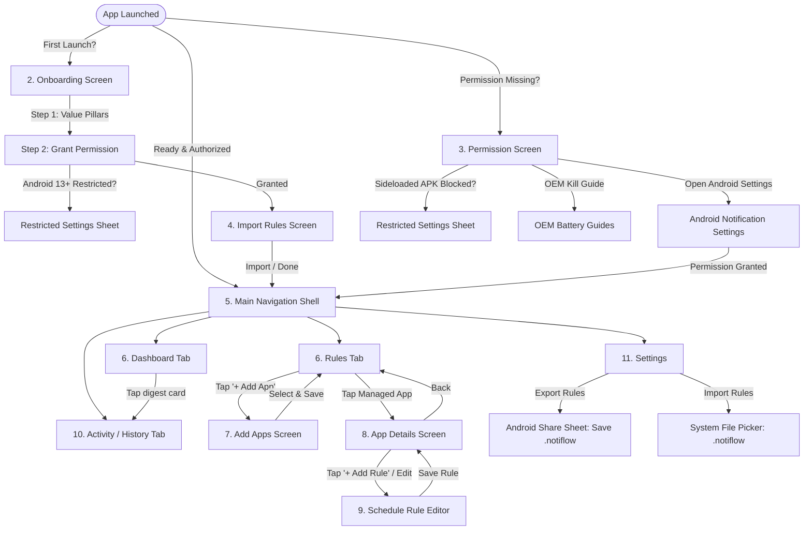

# Notiflow — App Features, Page Hierarchy & User Flow

> **Application**: Notiflow  
> **Privacy Philosophy**: 100% On-Device · Zero Telemetry · Zero Internet Permissions  
> **Platform Target**: Android (Release APK)  
> **UI Design System**: Stitch Obsidian Signal (Dark: `#09090B` / Card `#18181B` · Light: `#F9F9FB` / Card `#FFFFFF` · Signal Amber: `#F59E0B`)  
> **Design Reference**: [Google Stitch UI/UX Redesign](https://stitch.withgoogle.com/projects/14969607890769808827)

---

## 1. Executive Overview & Core Philosophy

**Notiflow** is an offline, privacy-first notification scheduler and focus manager built with Flutter. It grants users deterministic, schedule-based control over notifications from specific installed apps while leaving unmanaged apps completely untouched.

### Core Pillars
1. **Zero Telemetry & Zero Network Access**: The application completely omits the `android.permission.INTERNET` permission in `AndroidManifest.xml`. Incoming notifications are inspected in volatile local memory in microseconds and never leave the device.
2. **Deterministic Native Triage**: An on-device background service (`NotificationListenerService`) evaluates incoming notifications against user-defined rules in under 5 milliseconds.
3. **Unmanaged Apps Untouched**: Only apps explicitly chosen by the user are monitored; all other apps pass through without delay.
4. **Resilient Offline Architecture**: Operates reliably through reboots, offline/airplane mode, and without requiring any cloud account.
5. **Rules Portability & Presets**: Full support for exporting and importing `.notiflow` JSON backup files and applying curated focus presets (*Deep Work Protocol*, *Mindful Evening*, *Minimalist Default*).

---

## 2. Page Hierarchy & Total Page Count

Notiflow consists of **11 dedicated screens/pages** structured across a startup sequence, an onboarding/recovery layer, a primary Dashboard / Rules / Apps / Activity navigation shell (plus Settings), and contextual sub-screens, supplemented by modal sheets:

| # | Page / Screen Name | Type | Primary Role |
|---|---|---|---|
| **1** | **Startup Routing** (`resolveStartScreen` in `main.dart`) | No UI | Android shows the app icon while initializing, then opens Onboarding, Permission, or the Main Shell (no Flutter splash) |
| **2** | **Onboarding Screen** (`OnboardingScreen`) | First-Time Flow | Value pillars explanation and initial notification permission authorization |
| **3** | **Permission & Health Center** (`PermissionScreen`) | Recovery Screen | Access restoration, OEM battery kill guides, Android 13+ sideload helper |
| **4** | **Import Rules Screen** (`ImportRulesScreen`) | Onboarding Step 3 | Optional `.notiflow` backup import during onboarding |
| **5** | **Main Navigation Shell** (`MainNavigationShell`) | Container Screen | Phone bottom bar / tablet rail: Dashboard, Rules, Activity, Settings |
| **6** | **Dashboard / Rules Screen** (`DashboardScreen`) | Tabs 1 & 2 | `DashboardView.home`: greetings, Intercepted/Permitted metrics, quick pauses, digest overview. `DashboardView.rules`: managed apps list |
| **7** | **Add Apps Screen** (`AddAppsScreen`) | Sub-Screen (from Rules) | Device app discovery, search filtering, category chips, batch app addition |
| **8** | **App Details Screen** (`AppDetailsScreen`) | Sub-Screen | App master toggle, quick mute pills, schedule list |
| **9** | **Schedule Rule Editor** (`ScheduleEditorScreen`) | Sub-Screen | BLOCK vs ALLOW modes, time pickers with overnight math, 7-day selector pills |
| **10** | **Activity / History Screen** (`ActivityScreen`) | Tab 3 | Chronological 30-day triage feed with All / Silenced / Allowed / Digest filters |
| **11** | **Settings Screen** (`SettingsScreen`) | Tab 4 | Engine health, battery guides, storage badges, Saved Rules (fixed *Focus Hours* default; other saved rules can be fully edited in *Edit Saved Rule* or deleted), export/import backups, reset |

### Key Interactive Modals
* **Android 13+ Restricted Settings Sheet (`RestrictedSettingsSheet`)**: 2-step guide modal for sideloaded APK unlocking.
* **Paste JSON Rules Modal**: In-app modal dialog to paste raw `.notiflow` JSON directly.
* **Privacy & Security Audit Sheet**: Transparent on-device audit modal demonstrating zero network egress and zero tracking.
* **Reset All Rules Confirmation Modal**: Destructive data wipe warning dialog with native cache sync.

---

## 3. End-to-End App Flow

### Flow Walkthrough
1. **Cold Start Flow**:
   - The user opens Notiflow. Android's launch screen shows the app icon while the app loads preferences, then the right screen opens.
   - If first run: Dispatches to **Onboarding Screen**.
   - If returning user with permissions revoked (or OEM battery killed): Dispatches to **Permission Screen**.
   - If fully configured: Dispatches into the **Main Navigation Shell**.
2. **Permission & Sideloading Flow (Android 13+)**:
   - If Android restricts notification access due to sideloading (APK installation), the user taps the **Restricted Settings** guide.
   - Step 1 opens App Info (`ACTION_APPLICATION_DETAILS_SETTINGS`) $\rightarrow$ user taps `⋮` $\rightarrow$ *"Allow restricted settings"*.
   - Step 2 opens Notification Access (`ACTION_NOTIFICATION_LISTENER_SETTINGS`) $\rightarrow$ user turns Notiflow toggle ON.
   - App automatically detects permission resumption and advances to Step 3 (Rules Import) or Dashboard.
3. **Daily Management Flow**:
   - User views dynamic time greeting and triage counters on the **Dashboard (Rules)** tab.
   - User taps `+ Add App` to scan installed apps, selects target apps (e.g. WhatsApp, Slack), and adds them.
   - User taps a managed app to view the **App Details Screen** and sets up rules in the **Schedule Editor Screen** (e.g., Block 09:00 to 17:00 on weekdays).
   - Incoming notifications arriving during the scheduled window are silenced by the native engine.
   - User checks the **Activity** tab to inspect intercepted and permitted alerts.
4. **Backup & Portability Flow**:
   - User opens **Settings**, scrolls to **Rules Backup & Portability**, and taps **Export .notiflow File**.
   - The app generates a structured backup file containing all app configs and rules, opening the Android share sheet to save to Downloads, Google Drive, or messaging apps.
   - On a new device or fresh install, the user taps **Import** in Settings, picks a `.notiflow` file in the system file picker, and the configuration is restored in place. An **Import complete** bottom sheet then shows what was imported, what is waiting for install, what was skipped and which saved rules came with it.

---

## 4. Page-by-Page Contents & Detailed Feature Breakdown

---

### Page 1: Startup Routing (no splash screen)

* Notiflow has no Flutter splash. Android's launch screen shows the app icon while `main()` loads preferences and `ScheduleRepository`, then the first screen opens directly:
  - If `pref_onboarding_completed == false` $\rightarrow$ `OnboardingScreen`.
  - If `isNotificationAccessGranted() == false` $\rightarrow$ `PermissionScreen`.
  - Otherwise $\rightarrow$ `MainNavigationShell`.
* The Android launch window is a plain app-coloured background (light `#FEF8F6`, dark `#101412`); on Android 12+ the system starting-window icon is hidden.
---

### Page 2: Onboarding Screen (`OnboardingScreen`)

* **Purpose**: Guides first-time users through Notiflow's value proposition and assists them in granting notification access.
* **Visual & Functional Elements**:
  * **Step 1: Sovereign Protocol (Value Pillars)**:
    - Step indicator: `STEP 1 OF 3 · COGNITIVE PEACE OF MIND`.
    - Headline: *"Silence digital noise. Preserve your focus."*.
    - Three Value Pillar Cards:
      1. **Precision Time Shields**: Silence distracting notifications during work, study, or sleep without turning off notifications device-wide.
      2. **100% Sovereign & On-Device**: Zero cloud dependencies. No internet access requested. Your notification content never leaves memory.
      3. **Unmanaged Apps Untouched**: Non-configured apps behave normally with zero interception latency.
    - Button: *"Begin Setup"* (advances to Step 2).
  * **Step 2: Notification Access Setup**:
    - Step indicator: `STEP 2 OF 3 · PERMISSION HEALTH`.
    - Headline: *"Notification Access is required"*.
    - Subtitle explaining that Android requires notification listener permission to inspect and silence incoming alerts according to rules.
    - Button: *"Open Android Settings"* (launches `Settings.ACTION_NOTIFICATION_LISTENER_SETTINGS`).
    - Helper Card: *"Having issues enabling on Android 13+?"* which launches the `RestrictedSettingsSheet`.
    - Advances to Step 3 (`ImportRulesScreen`) once permission is granted.

---

### Page 3: Permission & Health Center (`PermissionScreen`)

* **Purpose**: Dedicated recovery hub shown when notification access is revoked, missing, or blocked by the operating system.
* **Visual & Functional Elements**:
  * **Status Card**:
    - Indicator: *"Focus Shield Offline"* or *"Notification Access is paused"*.
    - Visual warning state with action guidance.
  * **3-Step Guided Reconnection Checklist**:
    1. *Open Android Settings*
    2. *Find 'Notiflow' under 'Device & app notifications'*
    3. *Toggle the Notification Access switch to ON*
  * **Direct Action Buttons**:
    - Primary Button: *"Open Android Settings"*.
    - Secondary Link: *"Sideloaded APK blocked? Unlock restricted settings"*.
  * **OEM Background Protection Guides (Collapsible Accordions)**:
    - **OnePlus / Oppo**: Disable battery optimization, enable Auto-launch.
    - **Samsung**: Add to "Never sleeping apps", set battery to Unrestricted.
    - **Xiaomi / Redmi**: Enable "Autostart", set battery saver to "No restrictions".
  * **Live Lifecycle Observer**: Automatically checks permission status when the user returns from Android Settings.

---

### Page 4: Import Rules Screen (`ImportRulesScreen`)

* **Purpose**: Onboarding step three. Lets new users optionally restore a `.notiflow` backup before entering the app.
* **Visual & Functional Elements**:
  * `STEP 3 OF 3` pill, *"Import Rules"* headline, and a dashed `.notiflow` upload card that opens the system file picker (tablet also offers *"Or Paste Backup JSON"*).
  * *"Done"* completes onboarding and opens the Main Navigation Shell.
* **Settings import**: Settings → Import does not open this screen; it launches the system file picker directly and restores the selected `.notiflow` file in place.
* **Uninstalled apps choice (before import)**: if the backup has apps that aren't installed, a bottom sheet asks to *Keep in Vault* (rules kept and applied when the app is installed) or *Exclude These Apps*.
* **Import summary sheet (after import)**: a successful import (here or from Settings) opens an **Import complete** modal bottom sheet (`lib/presentation/widgets/import_summary_sheet.dart`) instead of a toast. It shows a summary line ("N apps · N rules · N saved rules") and collapsible sections, all expanded at first, each with a count and a down-arrow:
  * **Imported**: installed apps with their icon and active rule count.
  * **Waiting for install**: vaulted apps; their rules turn on when the app is installed. Each app has a **×** button that asks *"Remove <app>?"* and, on **Remove**, deletes the app and its saved rules from the vault (toast confirms; **Cancel** keeps it).
  * **Skipped**: excluded apps; nothing was imported for them.
  * **Saved rules**: names of the saved rules in the backup.
  * Buttons: **View Rules** (opens the Rules tab) and **Done**. Empty sections are hidden. Max 85% of screen height, scrolls when long; 560 px wide and centred on tablet. Invalid or empty files still show an error toast.
---

### Page 5: Main Navigation Shell (`MainNavigationShell`)

* **Purpose**: Core application scaffold hosting the bottom navigation bar and preserving tab state across sessions.
* **Visual & Functional Elements**:
  * **Bottom Navigation Bar (phone)**:
    - **Dashboard** — start tab: greeting, metrics, quick pauses and the Catch-Up Digest card.
    - **Rules** — managed apps and their schedules.
    - **Activity** — 30-day triage history and the Digest filter.
    - **Settings** — engine health, digest, backups and reset.
  * **Add Apps**: opened as its own page from the Rules tab ("Add App" / "Add Apps" buttons); system Back returns to Rules.
  * **Tablet**: the left rail shows the same four tabs.
  * **Back**: on any tab other than Dashboard, Back returns to Dashboard.
  * **Active Tab Highlighting**: High-contrast amber illumination with smooth indicator pill animation.

---

### Page 6: Dashboard / Rules Screen (`DashboardScreen`)

* **Purpose**: One screen with two views. `DashboardView.home` (Dashboard tab) shows greetings, triage metrics, quick temporary override pills and the Catch-Up Digest card; `DashboardView.rules` (Rules tab) shows the managed applications.
* **Catch-Up Digest card** (Dashboard): *"N silenced notifications — Review now"* counting unique notifications in unreviewed ended windows, or *"All caught up"*. Tapping opens Activity → Digest.
* **Visual & Functional Elements**:
  * **Dynamic Time-Based Greeting**:
    - Evaluates the device's clock to render contextual greetings paired with matching vector icons:
      - **05:00 – 11:59**: `"Good morning"` + `Icons.wb_twilight_rounded` (Warm Amber `#F59E0B`)
      - **12:00 – 16:59**: `"Good afternoon"` + `Icons.wb_sunny_rounded` (Solar Gold `#EAB308`)
      - **17:00 – 20:59**: `"Good evening"` + `Icons.brightness_medium_rounded` (Sunset Orange `#F97316`)
      - **21:00 – 04:59**: `"Good night"` + `Icons.bedtime_rounded` (Midnight Cyan `#38BDF8`)
    - Subtitle: *"Focus Shield active · Engine running locally"*.
  * **Restoration Banner**:
    - Dismissible alert card shown upon permission recovery: *"Focus Shield Online — ACCESS RESTORED"*.
  * **Summary Metrics Grid**:
    - **Silenced Notifications Card**: Counter with `Icons.notifications_paused_rounded`.
    - **Allowed Notifications Card**: Counter with `Icons.notifications_active_rounded`.
  * **Quick Mute · All apps** (`QuickMuteAllCard`, `lib/presentation/widgets/quick_mute_card.dart`, phone and tablet). Replaced the old Quick Session Overrides (phone) and Overrides / Mute All (tablet) sections.
    - Header "QUICK MUTE · ALL APPS", subtitle *"Silences every app for a while, on top of your schedules."*
    - Idle: three presets `15m` / `30m` / `1h`. They set the shared `global_mute` override, which silences every app (Rules apps and apps you haven't added). Only paused apps still ring through.
    - Active: the presets become a status card *"All apps muted · N min left · until HH:MM"* (refreshed every 15 s) with **+15m** (extends the end time, `ScheduleRepository.extendTemporaryMute`) and **End now** (clears it).
    - **Let repeat callers ring through** switch (`vipEmergencyBypass`); the row turns soft green while on. During a Quick Mute, a 2nd call from the same caller within 3 minutes rings (native `NativeScheduleEvaluator`, global-mute branch).
  * **Active Monitoring Cards (Managed Apps List)**:
    - Lists all apps currently monitored.
    - App icon, formatted name, package identifier, and current status chip (`SCHEDULED`, `MUTED`, or `ALWAYS ALLOWED`).
    - **Master Switch**: Custom toggle switch to pause/resume monitoring per app.
    - Tap card to open `AppDetailsScreen`.
    - **Multi-select delete**: long-pressing a card shows a selection bar with a select-all checkbox, *"N Selected"* and a red delete icon (icon only, no label or background) that asks *"Delete N Rules?"* before deleting.
    - **Uninstalled apps**: if an app with rules is uninstalled, its card turns grey, shows an `UNINSTALLED` badge instead of the status, and the toggle is disabled. Tapping still opens the details so the rule can be deleted; reinstalling the app restores the card.
  * **Floating Action Button (`+ Add App`)**: Jumps to `AddAppsScreen`.

---

### Page 7: Add Apps Screen (`AddAppsScreen`)

* **Purpose**: Scans installed applications on the device and enables users to add apps to Notiflow in batches.
* **Visual & Functional Elements**:
  * **Search bar (bottom, phone and tablet)**: Pill-shaped bar at the bottom of the page with the hint "Search" and a search icon, like the launcher app drawer. Live substring filtering by app label or package name. The bar floats over the list with a frosted blur, the list scrolls underneath it, and the list fades out at its top and bottom edges instead of being cut. Extra space at the end of the list lets the last app scroll fully above the bar.
  * **Category Filter Chips**:
    - `All Apps`, `Messaging`, `Social`, `Productivity`, `Other`, `System`. The label under each app name shows the same category.
    - Category is picked in `lib/domain/engine/app_category.dart` (`appCategoryFor`), in this order: messaging keywords (WhatsApp, Telegram, chat, SMS…) → Android's own app category (`ApplicationInfo.category`, Social or Productivity, sent by the native app list) → social/productivity keywords → **System** only if Android flags the app as a system (preinstalled) app → everything else is **Other**. Preinstalled apps with a known category (e.g. Gmail, Messages) stay in their category rather than System.
  * **App Discovery List**:
    - Uses the shared installed-apps list (loaded in the background when the dashboard opens), so the list appears instantly.
    - Icons load in screen-sized batches: about two screens first (computed from the real viewport, so a tablet's 2-column grid loads more), then the next batch when the user scrolls about halfway through what's loaded. Fast flings skip fetching; search or category changes fetch the visible matches first.
    - Displays extracted app icons, app names, package IDs, and selection checkboxes.
    - Already-managed apps are marked with an *"Already Managed"* badge.
  * **Sticky Bottom Action Bar**:
    - Displays selected count: *"Add (X) Apps to Focus Shield"*.
    - Batch adds selected apps and returns to Dashboard.

---

### Page 8: App Details Screen (`AppDetailsScreen`)

* **Purpose**: Dedicated management hub for an individual application, displaying its rules.
* **Visual & Functional Elements**:
  * **App Header**:
    - Large app icon, app label, category, and master monitoring switch.
  * The live *"Currently Silenced / Currently Permitted"* status card was removed in v1.6.1 (product owner decision). A live-status badge under the app name was tried and also rejected, so the page shows no live status.
  * **Quick Mute Pills**:
    - `15m Mute`, `30m Mute`, `1h Mute`, `Today 24h` buttons with instant override clearing.
  * **Assigned Schedule Rules List**:
    - Visual cards for all rules configured for this app.
    - Shows rule mode (`BLOCK MODE` in amber or `ALLOW MODE` in green), formatted 12h time range (`09:00 AM — 05:00 PM`), and overnight badges.
    - Quick toggle switch to activate or deactivate individual rules.
    - Delete button to remove rules.
  * **Add Rule FAB (`+ Add Schedule`)**: Navigates to `ScheduleEditorScreen`.

---

### Page 9: Schedule Rule Editor (`ScheduleEditorScreen`)

* **Purpose**: Form interface for creating and modifying time-based schedule rules.
* **Visual & Functional Elements**:
  * **Rule Name Input**: Text field to assign custom labels (e.g., *"Focus Hours"*, *"Sleep Shield"*).
  * **Interception Behavior (Mode Toggle)**:
    - **BLOCK Mode (Silence alerts)**: Notifications arriving in this interval are silenced.
    - **ALLOW Mode (Pass through)**: Notifications arriving in this interval pass through; silenced outside.
  * **Time Range Selector**:
    - Interactive Start Time and End Time pickers supporting 12h AM/PM and 24h formats.
    - **Overnight Interval Support**: Full support for windows crossing midnight (e.g., `20:00` to `08:00` next morning).
    - Live duration pill (`Duration: 8 hrs`), plus a `+1 DAY OVERNIGHT` badge for windows past midnight, shown right below the *TIME WINDOW · DAILY SCHEDULE* heading and above the Starts / Ends At cards (phone and tablet).
  * **Recurrence Days Selector**:
    - Quick preset selector chips: `Everyday`, `Weekdays`, `Weekends`.
    - 7 individual day toggle pills (`M`, `T`, `W`, `T`, `F`, `S`, `S`).
  * **Exceptions & Escalation**:
    - **Allow urgent repeated calls**: Passes priority alerts through if received twice within 3 minutes.
  * **Save Rule Action**: Validates input, saves to local storage, and syncs to the native engine.

---

### Page 10: Activity & Triage Log (`ActivityScreen`)

* **Purpose**: Chronological log of recent notifications and the actions taken by Notiflow.
* **Visual & Functional Elements**:
  * **Top Metrics Row**:
    - `Intercepted` counter, `Focus Gain` score, and `Leak Rate` percentage.
  * **Filter Bar**:
    - Segmented filter controls: `All`, `Silenced Only`, `Allowed Only`.
  * **Notification Event Stream**:
    - App icon, notification title, timestamp, and action badge (`SILENCED` in amber/coral, `ALLOWED` in green).
    - Triage reasoning tag: e.g. *"Blocked by 'Work Focus' rule"*, *"Allowed: Outside schedule"*, *"Muted by quick override"*.
    - **Conversation grouping**: back-to-back messages from the same app and person/chat with the same status, each within 30 minutes of the previous one, share one card showing *"time · N messages"* and the latest message. The arrow next to the sender expands the card in place to show every message; tapping the card opens the details sheet. Filter chips count messages; *"N Events"* counts cards.
    - Group-summary copies of a message and the user's own replies are not logged.
    - The log shows immediately; app names and icons come from the shared installed-apps list, and only icons of apps in the log are fetched.
    - Entries from apps that are no longer installed are greyed out and labelled *"Uninstalled"*.
    - **Swipe right to delete** (left to right) (phone and tablet): a soft light-red *"Delete"* background appears on the left and the card goes at once, with an *"Undo"* toast for 4 seconds; the database delete only happens when the toast closes without Undo. A grouped card deletes all of its messages. The details sheet also has a *"Delete"* button. Deleted messages also leave their Catch-Up Digest card; a digest card with nothing left disappears.
    - **Digest cards** can be swiped right too, which deletes every message that rule window silenced (from the digest and the log), with the same Undo.
  * **Header Action**: *"Clear Log"* button to wipe stored triage history.

---

### Page 11: Settings Screen (`SettingsScreen`)

* **Purpose**: Central controls for engine health, privacy metrics, rule backup/restore, triage preferences, and data reset.
* **Visual & Functional Elements**:
  * **ENGINE & BACKGROUND SERVICES**:
    - **Focus Shield Card**: Live permission status with a direct `"Manage Access"` button. When active it reads *"Filtering your notifications. You can turn this off anytime from Manage Access."*; when paused, *"Notification access is off. Grant access to start filtering."*
    - **Battery Optimization Card**: Battery status indicator with a guide for whitelisting Notiflow against OS killers.
  * **ON-DEVICE INTEGRITY & STORAGE**:
    - **Encrypted Local Storage Card**: Explains that all rules are stored strictly on-device, with a `24 KB` database badge aligned within card boundaries. Titled *"Encrypted Locally"* on phone (so it fits beside the AES-256 badge) and *"Encrypted Local Storage"* on tablet.
    - **Zero Telemetry Guarantee Card**: Highlights complete network isolation, zero analytics SDKs, and zero external tracking. No badge; the line reads *"No internet needed. Your data stays on this phone."* ("this device" on tablet).
    - **Privacy Audit Action**: Top app bar button opening the complete privacy audit sheet.
  * **RULES BACKUP & PORTABILITY (.notiflow file)**:
    - **Export Rules Backup**: One-tap action to serialize all rules into a `.notiflow` JSON file and launch the Android share sheet.
    - **Import Rules Backup**: Opens the system file picker directly and restores the selected `.notiflow` backup, then shows the **Import complete** summary sheet (see Page 4).
    - **Dormant Vault**: Full-width card below Export/Import (phone and tablet), always shown with an *"N APPS"* count. Tapping it opens a **Dormant Vault** bottom sheet listing every app whose rules are parked because it isn't installed (name, icon or initial, *"N rules saved"*). Each app has a **×** that asks *"Remove <app>?"*; **Remove** deletes the app and its saved rules (toast confirms) and the count updates live. With zero apps the card reads *"0 APPS · No uninstalled apps…"* and the sheet shows *"0 apps · no uninstalled apps"* and *"No uninstalled apps in the vault"*.
  * **TRIAGE & AUTOMATION PREFERENCES**:
    - **Silence ongoing notifications**: Toggle to filter persistent background notifications.
    - **Silence summary notifications**: Toggle to handle grouped notification bundles.
    - **Allow priority calls**: Toggle to let incoming phone calls through regardless of rules.
  * **CATCH-UP DIGEST** (Android only):
    - **Notify When Quiet Hours End**: Toggle (default on) for the single "quiet hours ended" notification. Shows `ALLOWED` or `NEEDS PERMISSION`; **Allow Notiflow Notifications** re-asks or opens Android's notification settings.
  * **DANGER ZONE**:
    - **Reset All Rules & Logs**: Red warning button opening a confirmation dialog. Clearing all rules resets the local database and empties the native daemon cache.
    - **Version Information**: Displays `Notiflow v1.4.0 (Build 4)`.

---

## 5. Modal Sheets & Interactive Overlays

### Restricted Settings Sheet (`RestrictedSettingsSheet`)
* **Triggered When**: Android 13+ restricts notification access for a sideloaded APK.
* **Contents**:
  * Clear explanation of Android 13+'s restricted settings security feature for non-Play Store APKs.
  * **Step 1 Button (`Open App Info`)**: Directly launches Notiflow's system App Info page via `ACTION_APPLICATION_DETAILS_SETTINGS`. Instructs the user to tap `⋮` (top-right menu) $\rightarrow$ select *"Allow restricted settings"* $\rightarrow$ authenticate with PIN/fingerprint.
  * **Step 2 Button (`Open Notification Access`)**: Directly opens Notification Access via `ACTION_NOTIFICATION_LISTENER_SETTINGS` where the toggle switch is now enabled.

### Toasts (`AppToast`, `lib/presentation/widgets/app_toast.dart`)
* **One place**: every screen calls `AppToast.show(context, message:, type:, actionLabel:)`. Look, motion and timing live only in this file, so a change there applies app-wide. A test fails if any screen calls `showSnackBar` directly.
* **Look**: rounded card (16 radius) with a type icon, message, × close button (or an action such as *"Undo"*), and a thin countdown bar along the bottom edge.
* **Types and colours** (from `AppTheme`):
  * Success: sage `#CCD5AE`, text `#3A4128`, check icon.
  * Info: soft blue `#D3E3EE`, text `#2C4A5E`, info icon. Used for neutral notices, cleared overrides and Undo deletes.
  * Warning: `#F59E0B`, white text.
  * Error: `#EF4444`, white text.
* **Motion**: slides in from the left, waits, then slides out to the right. Tapping × slides it out at once.
* **Timing**: 3 seconds; 4 seconds when it has an action, so there is time to tap Undo.
* **One at a time**: a new toast replaces the one on screen. The replaced one reports "replaced", so a pending delete is committed.
* **Position**: floats above everything (pages, dialogs, bottom sheets) through `AppToastHost` in `MaterialApp.builder`. It sits 12 px above the phone nav bar while that bar is on screen (`AppToastBottomBar`), otherwise above the system inset or keyboard.
* **Phone vs tablet**: full width with 12 px side margins on phone; at most 420 px wide and centred on tablet.

---

## 6. Summary of Key App Capabilities

* [x] **11 Dedicated Screens**: Complete coverage from onboarding to fine-grained rule editing and rules import/export.
* [x] **Dual Theme Support (Light & Dark)**: Full implementation of Stitch Obsidian Signal (`#09090B` Zinc) and Crisp Light (`#F9F9FB`) themes with high-contrast amber accent (`#F59E0B`).
* [x] **Rules Portability (.notiflow Backup)**: Full export and import workflows via local file storage, Android share sheet, and in-app JSON paste modal.
* [x] **Curated Protocols**: Pre-configured templates for *Deep Work*, *Mindful Evening*, and *Minimalist Default*.
* [x] **Dynamic Time Greetings**: Morning, afternoon, evening, and night greetings with matching colored vector icons.
* [x] **Animated Stitch Vector Icon**: 60/120 fps hardware-accelerated orbital rotation, radial aura pulse, and chime bounce.
* [x] **Overnight Interval Math**: Correctly handles overnight shifts crossing midnight (e.g. 20:00 to 08:00 next day).
* [x] **Temporary Overrides**: Quick 15m/30m/1h/2h/24h mute or allow overrides with countdown and one-tap restore.
* [x] **Android 13+ Sideloading Helper**: Built-in 2-step navigation flow to unlock restricted system settings.
* [x] **Zero Network Footprint**: Completely isolated, 100% on-device operation.

---

## 7. Planned Features

* [x] **Catch-Up Digest Phase 1**: Dashboard tab (greeting, Intercepted/Permitted cards, quick pauses, digest overview), Digest view in Activity, and on-device SQLite storage with 30-day retention.
* [x] **Catch-Up Digest Phase 2**: When a rule window ends, silenced notifications come back (Android snooze) and one short Notiflow notification says how many are back (device checks pending). Full spec and every agreed decision: [`docs/catch-up-digest.md`](docs/catch-up-digest.md).
* [x] **Shared installed-apps list & uninstalled apps** (v1.6.1): One app-wide installed-apps list loaded in the background from the dashboard; icons fetched on demand (Activity log shows instantly, Add Apps loads icons in screen-sized batches on phone and tablet); apps with rules that get uninstalled are shown greyed with an "Uninstalled" badge on Rules and Activity. Full spec: [`docs/installed-apps-cache.md`](docs/installed-apps-cache.md).
