<div align="center">

<picture>
  <source media="(prefers-color-scheme: dark)" srcset="docs/design-reference/phone/dark_mode/app_icon.png">
  <source media="(prefers-color-scheme: light)" srcset="docs/design-reference/phone/light_mode/app_icon.png">
  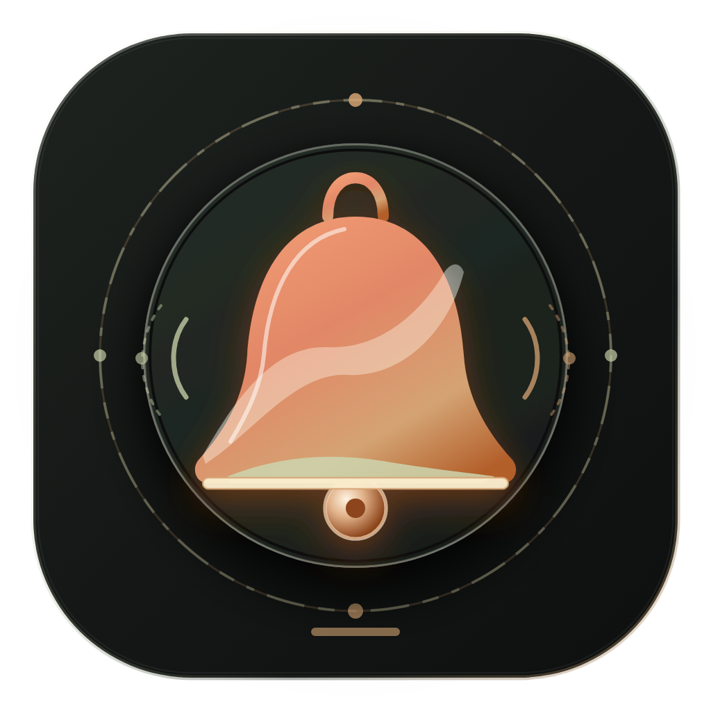
</picture>

# Notiflow

### **Privacy-First Notification Scheduler & Botanical Focus Sanctuary for Android**

*Quiet focus, on your schedule. **100% On-Device** · **Zero Telemetry** · **Zero Internet Permission**.*

<p align="center">
  <a href="https://github.com/nawabrahbar/notiflow/actions/workflows/build-apk.yml">
    
  </a>
  <a href="https://github.com/nawabrahbar/notiflow/releases/latest">
    
  </a>
  <a href="https://github.com/nawabrahbar/notiflow/releases/latest/download/notiflow-latest.apk">
    
  </a>
  <a href="https://github.com/nawabrahbar/notiflow/releases/latest/download/notiflow-latest.aab">
    
  </a>
  <a href="android/app/src/main/AndroidManifest.xml">
    
  </a>
  <a href="https://nawabrahbar.github.io/notiflow/privacy-policy.html">
    
  </a>
</p>

<p align="center">
  <a href="#-download--releases">📦 Download</a> •
  <a href="#-visual-showcase">📱 Screenshots</a> •
  <a href="#-key-features">✨ Key Features</a> •
  <a href="#-architecture--native-engine">🧭 Architecture</a> •
  <a href="#-botanical-sanctuary-design-system">🌿 Design System</a> •
  <a href="#-changelog--release-history">📋 Changelog</a> •
  <a href="#️-local-development--building">🛠️ Build from Source</a>
</p>

</div>

---

## 🌿 Overview

**Notiflow** is an offline, privacy-first Android application built with **Flutter** and a high-speed native **Kotlin `NotificationListenerService`** engine. Unlike all-or-nothing *Do Not Disturb* modes, Notiflow gives you deterministic, schedule-based control over when specific apps are allowed to notify you—silencing distractions in **`< 5ms`** during deep work or sleep while capturing muted notifications locally in an on-device vault so you never miss important details.

| Pillar | What Makes Notiflow Different |
| :--- | :--- |
| 🛡️ **100% Air-Gapped Privacy** | `android.permission.INTERNET` is completely omitted from [`AndroidManifest.xml`](android/app/src/main/AndroidManifest.xml). Your notification content and schedules physically cannot leave your device. |
| ⚡ **`< 5ms` Native Kotlin Triage** | Background [`NotificationHandlerListenerService.kt`](android/app/src/main/kotlin/com/notificationhandler/notification_handler/NotificationHandlerListenerService.kt) evaluates schedules natively—even when the Flutter UI is closed. |
| 📞 **Urgent Repeated Call Bypass** | Silences a first incoming call during quiet hours while arming a **180-second** window; a second call from the same caller within 3 minutes rings through immediately. |
| 🗄️ **Local Muted Notification Vault** | Every silenced alert is recorded locally with sender, full `EXTRA_BIG_TEXT` body, timestamp, and triage rule reason—plus 1-tap OTP copying and app launch. |
| 📐 **Adaptive Phone & Tablet UI** | Crafted in the **Botanical Sanctuary & Nocturne** aesthetic with responsive 2-column Bento layouts and an 88dp Navigation Rail on tablets (`≥600dp`). |

---

## 📦 Download & Releases

Every push to `main` is automatically built, signed, and published by GitHub Actions. Grab the latest installer below:

| Artifact | Direct Link | Purpose |
| :--- | :--- | :--- |
| 📲 **Direct Android Installer (`.apk`)** | **[Download `notiflow-latest.apk`](https://github.com/nawabrahbar/notiflow/releases/latest/download/notiflow-latest.apk)** | One-tap direct download of the newest signed Release `.apk` for any Android phone or tablet |
| 🏪 **Google Play Bundle (`.aab`)** | **[Download `notiflow-latest.aab`](https://github.com/nawabrahbar/notiflow/releases/latest/download/notiflow-latest.aab)** | Signed Android App Bundle (`.aab`) ready for Google Play Console upload |
| 🏷️ **Latest Release Notes** | **[View Latest Release (`v1.6.0`)](https://github.com/nawabrahbar/notiflow/releases/latest)** | Full release notes, versioned `.apk`, and versioned `.aab` |
| 🗂️ **All Releases Archive** | **[Browse All Releases](https://github.com/nawabrahbar/notiflow/releases)** | Complete history of all published Notiflow builds |
| ⚙️ **CI/CD Build Runs** | **[GitHub Actions Workflows](https://github.com/nawabrahbar/notiflow/actions/workflows/build-apk.yml)** | Live build logs, automated test verification, and workflow artifacts |

---

## 📱 Visual Showcase

### Phone Experience — *Botanical Nocturne (Dark)*

| **Dashboard (Rules)** | **Schedule Rule Editor** | **Muted Activity Vault** | **Settings & Privacy Audit** |
| :---: | :---: | :---: | :---: |
| 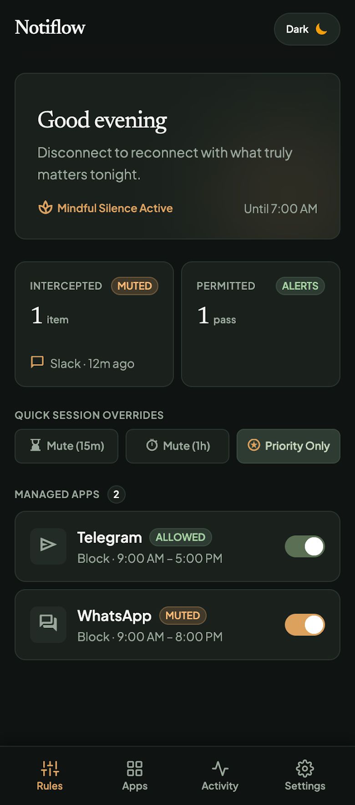 | 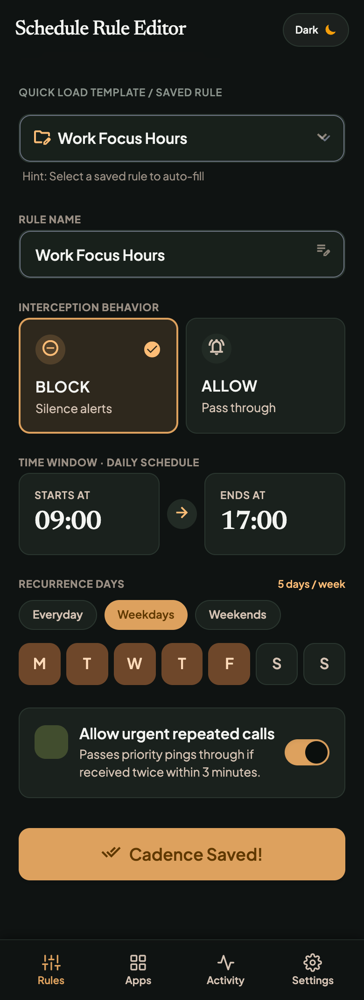 | 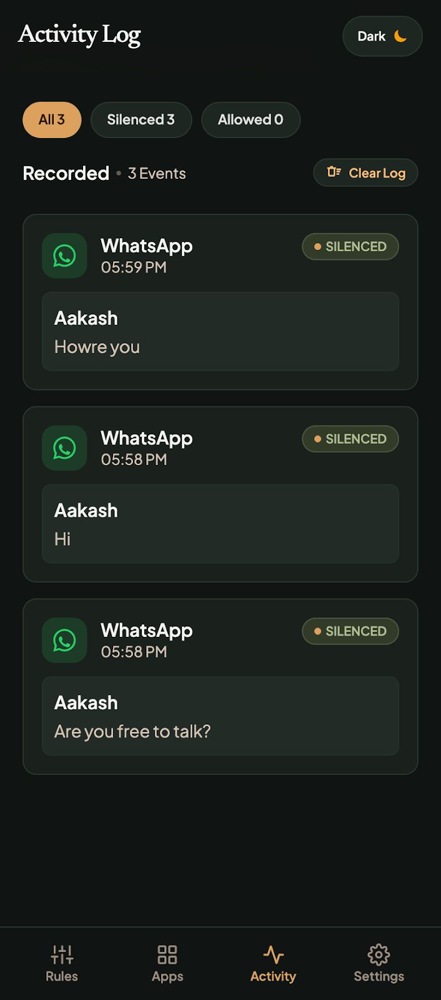 | 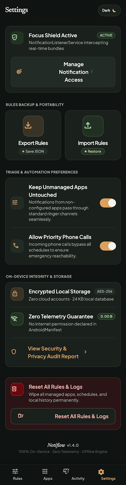 |
| *Time-aware greeting, triage counters & quick overrides* | *Quick-load templates, BLOCK/ALLOW & repeated call bypass* | *Full silenced message capture & 1-tap inspector* | *Service health, storage audit & `.notiflow` backups* |

<details>
<summary>☀️ <b>Click to expand Phone Experience — Botanical Sanctuary (Light Mode)</b></summary>
<br>

| **Dashboard (Rules)** | **Schedule Rule Editor** | **Muted Activity Vault** | **Settings & Privacy Audit** |
| :---: | :---: | :---: | :---: |
| 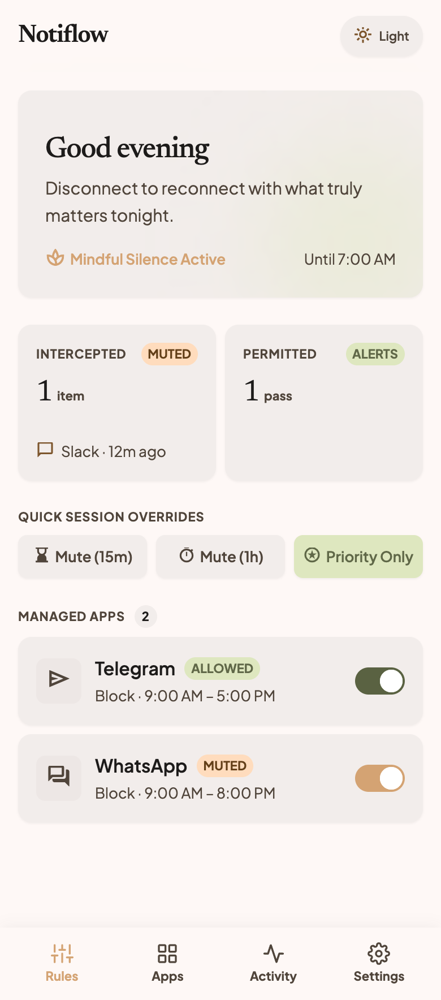 | 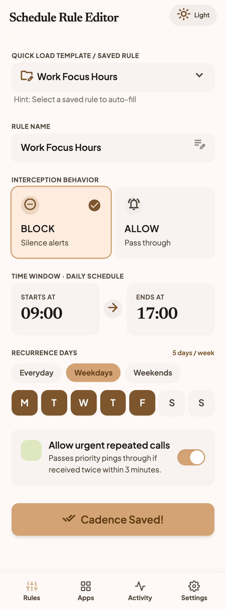 | 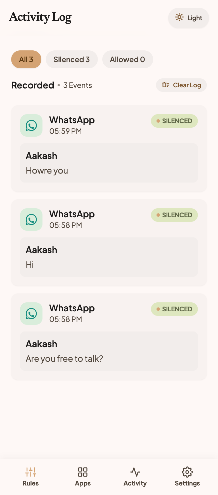 | 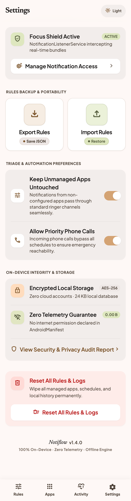 |

</details>

### Tablet Experience — *Adaptive Bento Split Layouts (`≥600dp`)*

| **Tablet Dashboard (`5:7` Two-Column Bento + Rail)** | **Tablet Schedule Editor (`7:5` Split View)** |
| :---: | :---: |
| 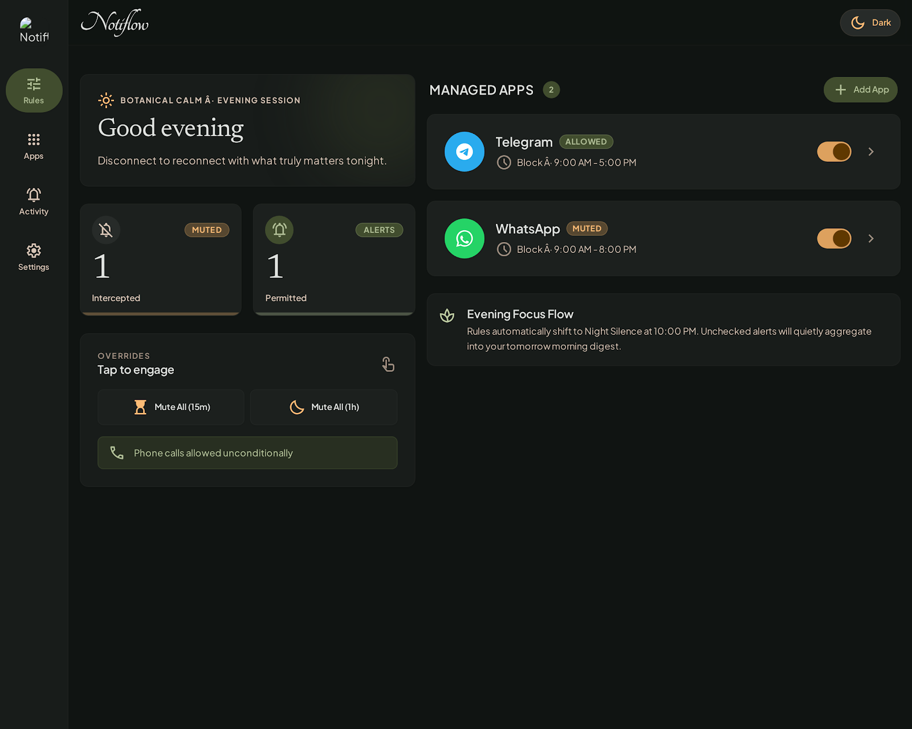 | 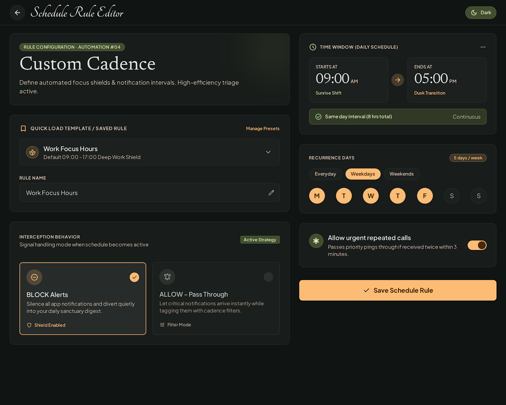 |
| 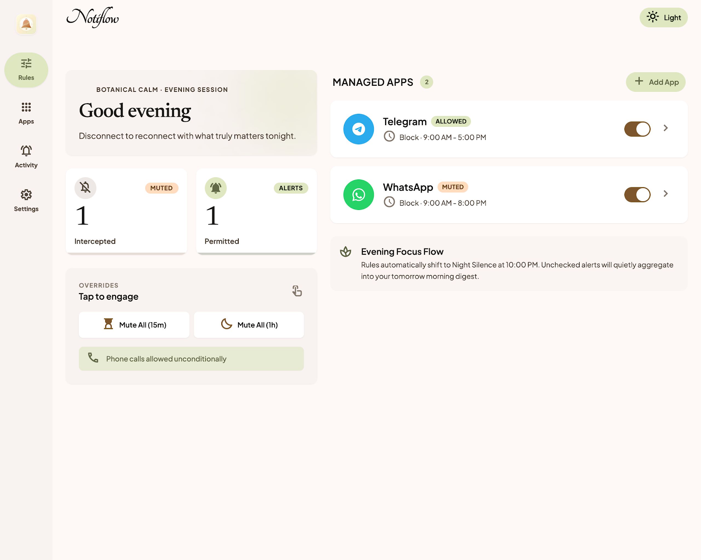 | 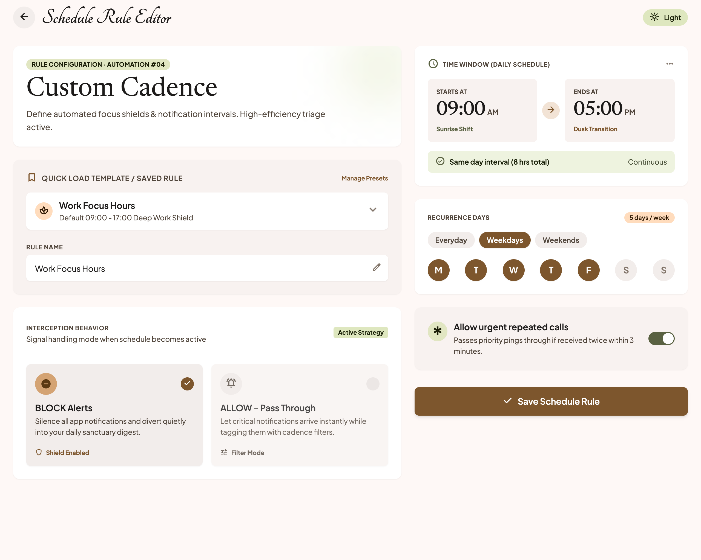 |

---

## ✨ Key Features

### 1. 🎯 Precision App-Specific Scheduling & Templates
- **Per-App Focus Rules**: Configure custom notification schedules for any installed application (WhatsApp, Slack, Teams, Gmail, Instagram, Telegram, etc.)—including **multiple independent schedules per app**.
- **Dual Interception Modes**:
  - **BLOCK Mode (`blockDuring` / `allDayBlock`)**: Silence notifications during the specified time window and allow them outside it.
  - **ALLOW Mode (`allowDuring` / `allDayAllow`)**: Only allow notifications during the specified window and silence them at all other times.
- **Quick Load Rule Templates**: Auto-fill schedules from reusable saved templates (pre-seeded with *"Work Focus Hours"* `09:00 – 17:00`, Mon–Fri) with automatic deduplication.
- **Overnight Schedule Math**: Seamlessly handles schedules that cross midnight (e.g., `20:00` to `08:00` the next morning) with full day-of-week awareness.
- **7-Day Recurrence & Flexible Time Formats**: Select individual days (`M` `T` `W` `T` `F` `S` `S`), one-tap presets (*Everyday*, *Weekdays*, *Weekends*), and toggle globally between **12-Hour (`AM/PM`)** and **24-Hour** display formats.

### 2. 📞 Urgent Repeated Call Bypass (`< 3 Minutes`)
- **Emergency Breakthrough**: When enabled on a rule, Notiflow intercepts and silences a caller's first ringing call during quiet hours while arming a **180-second** memory window.
- **Automatic Ring-Through**: If the same caller calls again within 3 minutes, the native Kotlin engine immediately allows the call notification and ringtone through.

### 3. 🗄️ Muted Notification Activity Log & Local Vault
- **Full Muted Notification Capture**: Whenever a notification arrives while an app is muted, Notiflow suppresses the status bar alert and records its complete details on-device:
  - **App Icon & Display Name**
  - **Notification Title / Sender** (contact name, group chat title, or email subject)
  - **Full Message Body** (supports multi-line `EXTRA_BIG_TEXT` and inbox-style lines)
  - **Channel / Subtext** & **Exact Timestamp**
  - **Triage Rule Reason** (e.g., `Blocked by ‘Work Focus’ rule (09:00 - 17:00)` or `Silenced by Global Mute override`)
- **Real-Time Feed & Filters**: Live-updating stream with **All**, **Silenced**, and **Allowed** filter chips, pull-to-refresh, and focus metrics.
- **Interactive Notification Inspector**: Tap any recorded notification card to open a bottom sheet with full selectable text (`SelectableText` for copying OTPs or links) and a one-tap **Open App** launcher.

### 4. ⚡ Quick Session Overrides (Global & Per-App)
- **Global Session Overrides**: Engage **Mute All (15m)**, **Mute All (1h)**, or **Pass Calls** directly from the Dashboard with a live countdown banner and one-tap **Restore**.
- **Per-App Instant Mute Pills**: Temporarily mute any individual app for **15m**, **30m**, **1h**, or **Today 24h** from the App Details screen without altering recurring schedules.

### 5. 💾 Unified `.notiflow` Backups, Dormant Vault & Focus Protocols
- **Native `.notiflow` File Export & 1-Tap Import**: Serialize all managed apps, schedules, rule templates, and preferences into a `.notiflow` file (`notiflow_backup_<timestamp>.notiflow`) via Android's Storage Access Framework (`ACTION_CREATE_DOCUMENT` / `ACTION_OPEN_DOCUMENT`) or clipboard JSON.
- **Smart Dormant App Vault**: When importing a `.notiflow` backup containing apps not currently installed on your device, choose **"Keep in Vault & Auto-Apply on Install"** to park rules safely in the local database and automatically activate them the moment those apps are installed.
- **3 Built-In Focus Protocols**:
  - 🧠 **Deep Work Protocol**: Blocks Slack, Teams, and Gmail from `09:00 – 17:00` (Mon–Fri).
  - 🌙 **Mindful Evening**: Blocks Instagram, X, and YouTube overnight from `20:00 – 08:00` (Everyday).
  - 🍃 **Minimalist Default**: Holds WhatsApp notifications 24/7 while letting phone calls and SMS pass through.

### 6. 🔒 100% On-Device Privacy & Zero Telemetry
- **Zero Network Access**: `android.permission.INTERNET` is completely absent from [`AndroidManifest.xml`](android/app/src/main/AndroidManifest.xml).
- **Zero-Network Play Store Updates**: Uses Google Play Core IPC (`in_app_update`) for update checks without requiring internet permissions inside Notiflow.
- **Official Privacy Policy**: Published at **[nawabrahbar.github.io/notiflow/privacy-policy.html](https://nawabrahbar.github.io/notiflow/privacy-policy.html)** and [`PRIVACY_POLICY.md`](PRIVACY_POLICY.md).

---

## 🧭 Architecture & Native Engine

Notiflow decouples its background notification interception from the Flutter UI so schedules execute reliably with zero battery drain—even when the Flutter engine is not running.

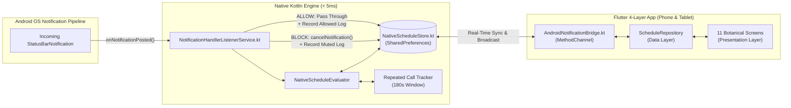

### Native Android Engine (`android/app/src/main/kotlin/...`)
- **[`NotificationHandlerListenerService.kt`](android/app/src/main/kotlin/com/notificationhandler/notification_handler/NotificationHandlerListenerService.kt)**: System-bound `NotificationListenerService` that intercepts posted notifications, evaluates incoming calls for the 3-minute repeated call bypass, extracts title/message/channel extras, records triage events, and cancels muted notifications in `< 5ms`.
- **[`NativeScheduleStore.kt`](android/app/src/main/kotlin/com/notificationhandler/notification_handler/NativeScheduleStore.kt)**: Pure Kotlin schedule evaluator (`NativeScheduleEvaluator`) and persistent store (`SharedPreferences`) that runs independently of the Flutter UI lifecycle.
- **[`AndroidNotificationBridge.kt`](android/app/src/main/kotlin/com/notificationhandler/notification_handler/AndroidNotificationBridge.kt)**: MethodChannel bridge (`com.notificationhandler/bridge`) connecting Flutter with Android package discovery, direct Notification Access deep-linking (`ACTION_NOTIFICATION_LISTENER_DETAIL_SETTINGS`) with automatic foreground return, `.notiflow` file import/export, app launching, and live activity broadcasts.

### Flutter 11-Screen Architecture (`lib/`)

| # | Screen | Source File | Key Responsibilities |
| :--- | :--- | :--- | :--- |
| 1 | **Splash Screen** | [`lib/presentation/screens/splash_screen.dart`](lib/presentation/screens/splash_screen.dart) | Animated emblem, native store sync, smart route dispatch |
| 2 | **Onboarding Screen** | [`lib/presentation/screens/onboarding_screen.dart`](lib/presentation/screens/onboarding_screen.dart) | 3-step editorial onboarding with direct 1-tap notification access setup |
| 3 | **Permission Center** | [`lib/presentation/screens/permission_screen.dart`](lib/presentation/screens/permission_screen.dart) | 2-step permission recovery with auto-return & OEM battery guidance |
| 4 | **Import & Presets** | [`lib/presentation/screens/import_rules_screen.dart`](lib/presentation/screens/import_rules_screen.dart) | `.notiflow` file picker, Dormant Vault prompt, JSON paste, and 3 focus presets |
| 5 | **Navigation Shell** | [`lib/presentation/screens/main_navigation_shell.dart`](lib/presentation/screens/main_navigation_shell.dart) | Adaptive bottom bar (`<600dp`) and 88dp left Navigation Rail (`≥600dp`) |
| 6 | **Dashboard (Rules)** | [`lib/presentation/screens/dashboard_screen.dart`](lib/presentation/screens/dashboard_screen.dart) | Time-based greeting, triage counters, global overrides, managed apps bento |
| 7 | **Add Apps Screen** | [`lib/presentation/screens/add_apps_screen.dart`](lib/presentation/screens/add_apps_screen.dart) | Installed app discovery, search, and 5 category filter chips |
| 8 | **App Details Screen** | [`lib/presentation/screens/app_details_screen.dart`](lib/presentation/screens/app_details_screen.dart) | Real-time triage status card, quick mute pills, multi-schedule list |
| 9 | **Schedule Editor** | [`lib/presentation/screens/schedule_editor_screen.dart`](lib/presentation/screens/schedule_editor_screen.dart) | Quick Load Template dropdown, BLOCK/ALLOW mode, time pickers, call bypass |
| 10 | **Activity Log** | [`lib/presentation/screens/activity_screen.dart`](lib/presentation/screens/activity_screen.dart) | Muted notification vault, filter chips, `SelectableText` inspector & app launcher |
| 11 | **Settings Screen** | [`lib/presentation/screens/settings_screen.dart`](lib/presentation/screens/settings_screen.dart) | Service health, privacy audit, 12h/24h format, `.notiflow` backup/restore |

---

## 🌿 Botanical Sanctuary Design System

Introduced in **v1.6.0**, Notiflow pairs editorial typography (**Newsreader** display serifs + **Plus Jakarta Sans** body) with a tranquil dual-palette theme and Android 13+ **Material You dynamic monochrome icon** support:

| Token Role | ☀️ Botanical Sanctuary (Light) | 🌙 Botanical Nocturne (Dark) |
| :--- | :--- | :--- |
| **Primary Canvas** | Warm Canvas (`#FEF8F6`) | Deep Forest (`#101412`) |
| **Primary Accent** | Warm Terracotta (`#7D562D`) | Luminous Amber-Terracotta (`#FCBC76`) |
| **Secondary Accent** | Botanical Sage (`#5A6242`) | Soft Sage (`#BECCA3`) |
| **Semantic Toasts** | Success `#22C55E` · Warning `#F59E0B` · Error `#EF4444` | Success `#22C55E` · Warning `#F59E0B` · Error `#EF4444` |

---

## 📋 Changelog & Release History

### 🚀 **v1.6.0 (`+10`) — Botanical Sanctuary Redesign, Rule Templates, Tablet Expansion & Native Hardening** *(Latest)*
- **Botanical Sanctuary & Nocturne Redesign**: Warm Canvas (`#FEF8F6`) / Deep Forest (`#101412`), Terracotta (`#7D562D` / `#FCBC76`), and Sage Green (`#5A6242` / `#BECCA3`) with Newsreader display serifs and Plus Jakarta Sans body typography.
- **Seamless Canvas Flow**: Eliminated header bottom borders and dividers across all screens for a unified surface.
- **Urgent Repeated Call Bypass (`< 3 Minutes`) Native Fix**: Fixed incoming call interception in [`NotificationHandlerListenerService.kt`](android/app/src/main/kotlin/com/notificationhandler/notification_handler/NotificationHandlerListenerService.kt) & [`NativeScheduleStore.kt`](android/app/src/main/kotlin/com/notificationhandler/notification_handler/NativeScheduleStore.kt). A 1st call during quiet hours is silenced while arming a 3-minute window; a 2nd call from the same caller within 180 seconds rings through immediately.
- **Material You Dynamic Themed App Icon**: Added monochrome adaptive launcher icon layer (`<monochrome>`) for Android 13+ themed home screens.
- **First-Launch Theme Sync & Explicit User Preference**: Follows device system appearance on initial launch and persists explicit user theme toggles across sessions.
- **Responsive Phone & Tablet Architecture (`≥600dp`)**: Adaptive 88dp left Navigation Rail and multi-column Bento split layouts across Dashboard (`5:7`), Add Apps (2-col grid), App Details (`5:7`), Schedule Editor (`7:5`), and Settings (`6:6`).
- **Smart Backup Import & Dormant Vault**: Detects uninstalled apps in `.notiflow` backups and offers to *"Keep in Vault & Auto-Apply on Install"* or *"Exclude These Apps"*.
- **Quick Load Rule Templates & Multiple Schedules per App**: Reusable schedule rule dropdown pre-seeded with *"Work Focus Hours"* (`09:00 – 17:00`, Mon–Fri) and support for multiple independent rules per app.
- **Google Play In-App Updates & 12h/24h Time Format**: Added Play Core IPC update checks (with zero `INTERNET` permission) and configurable 12-hour / 24-hour time formatting.

<details>
<summary>📜 <b>View Previous Releases (v1.5.0 – v1.5.4)</b></summary>
<br>

- **v1.5.4 (`+9`) — Direct Permission Deep-Link, Auto-Return & Clean Play Store Onboarding**:
  - Removed sideloaded APK warning cards from [`onboarding_screen.dart`](lib/presentation/screens/onboarding_screen.dart) and [`permission_screen.dart`](lib/presentation/screens/permission_screen.dart) for a clean Play Store onboarding experience.
  - Updated [`AndroidNotificationBridge.kt`](android/app/src/main/kotlin/com/notificationhandler/notification_handler/AndroidNotificationBridge.kt) to deep-link directly to Notiflow's `Allow notification access` switch (`Settings.ACTION_NOTIFICATION_LISTENER_DETAIL_SETTINGS`) on Android 11+ with automatic foreground return on grant.
- **v1.5.3 (`+8`) — Semantic Toast Colors by State**:
  - Unified all `SnackBar` toasts across the app with semantic state colors: **Success Green** (`#22C55E`), **Error Red** (`#EF4444`), and **Warning Orange** (`#F59E0B`).
- **v1.5.2 (`+7`) — Google Play Store `.aab` Bundle & Release Signing**:
  - Configured release upload keystore signing in [`android/app/build.gradle.kts`](android/app/build.gradle.kts) and updated [`.github/workflows/build-apk.yml`](.github/workflows/build-apk.yml) to publish signed `.aab` bundles alongside `.apk` installers.
- **v1.5.1 (`+6`) — Real `.notiflow` Backup File Export/Import & Play Store Privacy Policy**:
  - Updated **Export Rules Backup** in [`AndroidNotificationBridge.kt`](android/app/src/main/kotlin/com/notificationhandler/notification_handler/AndroidNotificationBridge.kt) to save `.notiflow` files via Android's system file saver (`ACTION_CREATE_DOCUMENT`) and enabled direct 1-tap `.notiflow` file selection on [`ImportRulesScreen`](lib/presentation/screens/import_rules_screen.dart).
  - Added Play Console-compliant [`PRIVACY_POLICY.md`](PRIVACY_POLICY.md) and GitHub Pages [`docs/privacy-policy.html`](docs/privacy-policy.html).
- **v1.5.0 (`+5`) — Muted Notification Activity Log & Automated GitHub Releases**:
  - Added full muted notification capture (title, message body, subtext, rule reason, app icon, real-time feed updates, and interactive details bottom sheet with **Open App**).
  - Added automated GitHub Actions CI/CD workflow for building and publishing release artifacts.

</details>

---

## 🛠️ Local Development & Building

### Prerequisites
- **Flutter SDK**: `>= 3.44.0` (Dart `>= 3.13.4`)
- **Java / Android**: JDK 17 & Android SDK

### Quick Start Commands
```bash
# 1. Install Flutter dependencies
flutter pub get

# 2. Run Dart unit & widget test suites
flutter test

# 3. Build Release APK & Google Play App Bundle (.aab)
flutter build apk --release
flutter build appbundle --release
```

> [!TIP]
> For deep-dive screen specifications, platform architecture decisions, and native notification flow diagrams, explore [`APP_FEATURES.md`](APP_FEATURES.md), [`PRIVACY_POLICY.md`](PRIVACY_POLICY.md), and the [`docs/`](docs/) directory.

---

<div align="center">
  <sub>Built with 🌿 for quiet, distraction-free focus · <b>100% On-Device Privacy</b></sub>
</div>
